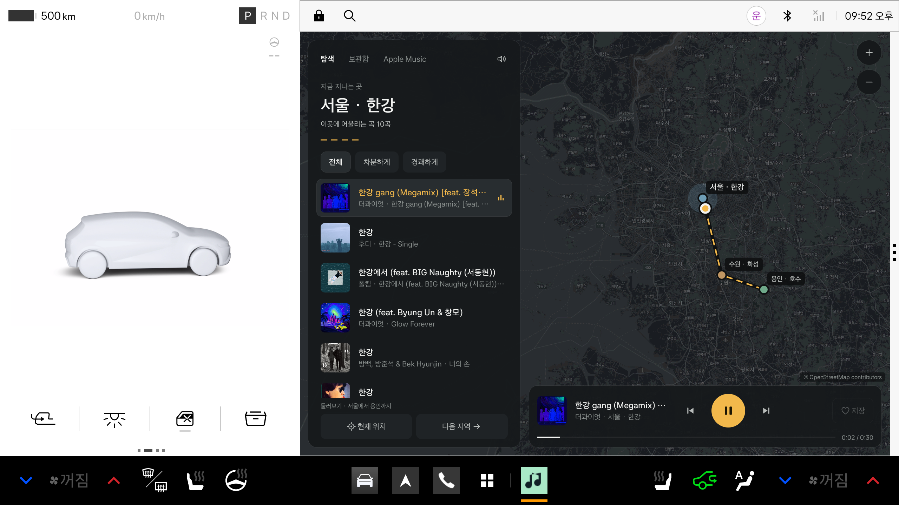

# 길 위의 음악

차가 지금 지나는 곳과 주행 상황을 읽어, 그 길에 어울리는 음악을 알아서 이어 틀어 주는 Pleos Connect 차량용 음악 앱입니다.
현대자동차그룹 차량용 앱 개발 공모전 출품작입니다.

| 지나는 곳에 맞춘 선곡 (Pleos Connect 에뮬레이터) | 주행 중 화면 |
| --- | --- |
|  |  |

## 무엇을 하나요

- **장소**: 차량 위치(Pleos FusedLocation)로 지금 지나는 지역을 판별하고, 그곳의 곡으로 다음 재생 목록을 바꿉니다. 재생 중인 곡은 끊지 않습니다.
- **그곳의 인기곡**: 지역에 들어서면 Apple Music 카탈로그에서 그 장소를 노래한 곡을 인기순으로 가져와 목록 맨 위에 올립니다(예: 한강 → 「한강」, 「한강에서」). 30초 미리듣기로 재생되며, 연결이 없으면 내장 곡만 나옵니다.
- **차의 상태**: 앞 유리 와이퍼가 켜지면 차분한 곡부터, 스포츠 모드면 경쾌한 곡부터 틀도록 순서를 바꿉니다(Pleos Vehicle SDK).
- **목소리**: 지역에 들어서거나 분위기가 바뀌면 한 문장으로 알려 줍니다(Pleos TextToSpeech SDK, 온디바이스 모드). 같은 문장을 화면 자막으로도 보여 줍니다.
- **주행 중 화면**: 차량이 주행 제한을 알리면 목록·지도 조작을 치우고, 지역 이름·곡 제목·재생 버튼 3개만 크게 남깁니다.
- **Apple Music**: 로그인 없이 카탈로그의 실제 곡을 검색해 30초 미리듣기로 듣고, 실제 앨범 커버를 보여 줍니다(Apple Music API). 계정 로그인과 전체 곡 재생은 코드만 준비된 상태입니다.
- 차량 미디어 세션(MediaBrowserService / MediaSession), 오디오 포커스, 보관함, 장르 필터를 지원합니다.

수록곡 6개는 직접 합성한 시연용 창작 음원이고, 지역은 서울 한강 · 수원 화성 · 용인 호수 3곳입니다.

## 실행 방법

1. Android Studio(또는 Android SDK 34, JDK 17 이상)를 준비합니다.
2. `car-app/local.properties`에 SDK 경로를 적습니다. 예: `sdk.dir=/Users/이름/Library/Android/sdk`
3. Pleos Connect 에뮬레이터를 실행한 뒤 설치합니다.

```bash
cd car-app
./gradlew :app:assemblePleosDebug
adb install -r app/build/outputs/apk/pleos/debug/app-pleos-debug.apk
adb shell am start -n com.musicmap.car/.MainActivity
```

앱에서 **경로 둘러보기 → 재생 → 다음 지역** 순서로 누르면 서울에서 수원, 용인으로 이동하며 곡과 안내가 바뀝니다.
둘러보기는 가상 주행이며, 수원~용인 구간에서 비 오는 상황을 함께 보여 줍니다. 실제 주행에서는 차량 신호를 사용합니다.

일반 Android 기기·에뮬레이터에서는 `standard` 변형을 씁니다(`./gradlew :app:assembleStandardDebug`).
Windows에서는 `car-app/run.ps1`이 에뮬레이터 실행부터 설치까지 한 번에 처리합니다.

## 테스트 환경과 필요한 설정

| 항목 | 값 |
| --- | --- |
| Pleos Connect 에뮬레이터 | v2.1.0 (Android API 34, Automotive) |
| 화면 규격 | 2560×1440, 160dpi (앱 창 1682×1210dp, 가로) |
| AVD 설정 | RAM 4GB, Cold boot |
| 최소 / 대상 SDK | API 28 / API 34 |
| 사용 SDK | FusedLocation 1.1.3, Vehicle 2.3.2, TextToSpeech 3.3.1 |
| 권한 | 위치, `pleos.car.permission.FUSED_LOCATION`, `CAR_DRIVE`, `CAR_WINDOWS`, `TTS_SERVICE`, 알림 |
| 네트워크 | 지도 타일(OpenStreetMap)과 Apple Music 검색·미리듣기에 사용. 지역 수록곡은 앱에 내장되어 오프라인에서도 재생됩니다 |
| Apple Music | `car-app/local.properties`의 `appleMusic.developerToken`(서명된 개발자 JWT)이 있어야 검색이 켜집니다. 저장소의 APK에는 토큰을 넣지 않았습니다 |

검증 범위와 아직 확인하지 못한 항목은 [검증 기록](car-app/docs/VALIDATION.md)에 구분해 적었습니다.

## APK

- 위치: [`apk/ReMelody_길위의음악_release.apk`](apk/ReMelody_길위의음악_release.apk) (Pleos 변형, release 서명)
- 직접 만들기: `car-app/local.properties`에 `release.storeFile`, `release.storePassword`, `release.keyAlias`, `release.keyPassword`를 적고 `./gradlew :app:assemblePleosRelease`

## 더 보기

- [개발 문서](car-app/README.md): 구조, 테스트, 남은 작업
- [Pleos 실행 가이드](car-app/docs/PLEOS.md)
- [Apple Music 연동 상태](car-app/docs/APPLE_MUSIC.md): 검색·미리듣기 동작. 계정 연결·전체 곡 재생은 개발용 경로로 Pleos 에뮬레이터에서 확인
