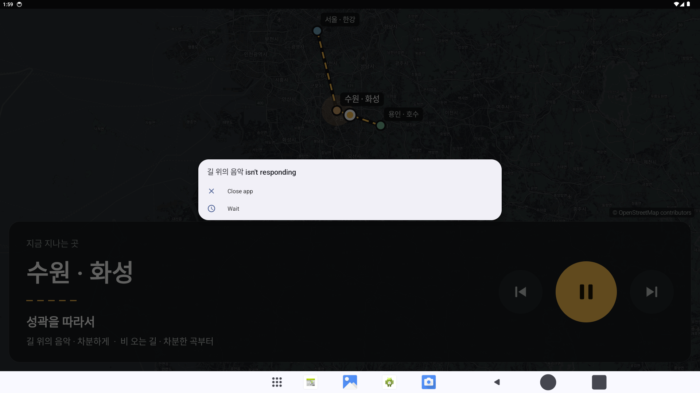

# 길 위의 음악

차가 지금 지나는 곳과 주행 상황을 읽어, 그 길에 어울리는 음악을 알아서 이어 틀어 주는 Pleos Connect 차량용 음악 앱입니다.
현대자동차그룹 차량용 앱 개발 공모전 출품작입니다.

| 지나는 곳에 맞춘 선곡 (Pleos Connect 에뮬레이터) | 주행 중 화면 |
| --- | --- |
|  |  |

## 무엇을 하나요

- **드라이브 트랙**: 목적지를 고르면 도로 경로를 받아, 그 길이 지나는 구간(도로·랜드마크)을 순서대로 찾고 구간마다 정해 둔 곡을 이어 붙입니다. 강남대로에서는 「강남스타일」, 동탄지성로에서는 박지성 응원가 「위송빠레」가 나옵니다.
- **미리 만든 매핑**: 구간과 곡의 짝은 앱 안의 표에 적혀 있습니다(`Catalog.kt`). 주행 중에는 "지금 어느 구간인가"만 계산하고, 문장이나 곡을 생성하지 않습니다.
- **날씨**: 차의 위치로 현재 날씨를 조회해 순서를 바꾸고 날씨에 맞는 곡을 한두 곡 끼워 넣습니다. 와이퍼가 켜져 있으면 예보와 상관없이 비로 봅니다(Pleos Vehicle SDK).
- **구간 안내**: 새 구간에 들어서면 한 문장으로 알려 줍니다(Pleos TextToSpeech SDK, 온디바이스). 같은 문장이 자막으로 뜨고, 스피커 버튼으로 끌 수 있습니다.
- **내 곡 지정**: 지금 있는 구간에 Apple Music의 곡을 골라 지정하면 그 구간의 첫 곡이 됩니다. 정차 중에만 할 수 있습니다.
- **주행 중 화면**: 차량이 주행 제한을 알리면 목록·지도 조작을 치우고, 커버·지역 이름·곡 제목·재생 버튼 3개만 크게 남깁니다.
- **Apple Music**: 로그인 없이 검색과 30초 미리듣기, 계정을 연결하면 전체 곡 재생.
- 경로를 벗어나면 남은 길의 트랙을 다시 만듭니다. 차량 미디어 세션, 오디오 포커스, 보관함을 지원합니다.

다른 사용자와 트랙을 나누는 기능과 구간별 인기 곡은 서버가 필요해 아직 없습니다.
구간은 5곳(서울 한강, 수원 화성, 용인 호수, 강남대로, 동탄지성로)이고, 내장 곡 6개는 직접 합성한 시연용 음원입니다.

## 실행 방법

1. Android Studio(또는 Android SDK 34, JDK 17 이상)를 준비합니다.
2. `car-app/local.properties`에 SDK 경로를 적습니다. 예: `sdk.dir=/Users/이름/Library/Android/sdk`
3. Pleos Connect 에뮬레이터를 실행한 뒤 설치합니다.

```bash
cd car-app
./gradlew :app:assemblePleosDebug
adb install -r app/build/outputs/apk/pleos/debug/app-pleos-debug.apk
adb shell am start -n com.musicmap.car/.MainActivity
```

앱에서 **목적지 정하기 → 경로 둘러보기 → 재생 → 다음 지역** 순서로 누르면 목적지까지 구간을 넘어가며 곡과 안내가 바뀝니다.
둘러보기는 가상 주행입니다. 날씨는 그 위치의 실제 값을 씁니다.

일반 Android 기기·에뮬레이터에서는 `standard` 변형을 씁니다(`./gradlew :app:assembleStandardDebug`).
Windows에서는 `car-app/run.ps1`이 에뮬레이터 실행부터 설치까지 한 번에 처리합니다.

## 테스트 환경과 필요한 설정

| 항목 | 값 |
| --- | --- |
| Pleos Connect 에뮬레이터 | v2.1.0 (Android API 34, Automotive) |
| 화면 규격 | 2560×1440, 160dpi (앱 창 1682×1210dp, 가로) |
| AVD 설정 | RAM 4GB, Cold boot |
| 최소 / 대상 SDK | API 28 / API 34 |
| 사용 SDK | FusedLocation 1.1.3, Vehicle 2.3.2, TextToSpeech 3.3.1 |
| 권한 | 위치, `pleos.car.permission.FUSED_LOCATION`, `CAR_DRIVE`, `CAR_WINDOWS`, `TTS_SERVICE`, 알림 |
| 네트워크 | 지도 타일(OpenStreetMap), 경로(OSRM 공개 서버), 날씨(Open-Meteo), Apple Music에 사용. 연결이 없으면 내장 곡과 직선 경로로 동작합니다 |
| 밖으로 나가는 위치 | 날씨 조회에는 약 1km 단위로 반올림한 좌표, 경로 조회에는 출발·도착 좌표를 보냅니다 |
| Apple Music | `car-app/local.properties`의 `appleMusic.developerToken`(서명된 개발자 JWT)이 있어야 검색이 켜집니다. 저장소의 APK에는 토큰을 넣지 않았습니다 |

검증 범위와 아직 확인하지 못한 항목은 [검증 기록](car-app/docs/VALIDATION.md)에 구분해 적었습니다.

## APK

- 위치: [`apk/ReMelody_길위의음악_release.apk`](apk/ReMelody_길위의음악_release.apk) (Pleos 변형, release 서명)
- 직접 만들기: `car-app/local.properties`에 `release.storeFile`, `release.storePassword`, `release.keyAlias`, `release.keyPassword`를 적고 `./gradlew :app:assemblePleosRelease`

## 더 보기

- [개발 문서](car-app/README.md): 구조, 테스트, 남은 작업
- [Pleos 실행 가이드](car-app/docs/PLEOS.md)
- [Apple Music 연동 상태](car-app/docs/APPLE_MUSIC.md): 검색·미리듣기 동작. 계정 연결·전체 곡 재생은 개발용 경로로 Pleos 에뮬레이터에서 확인
