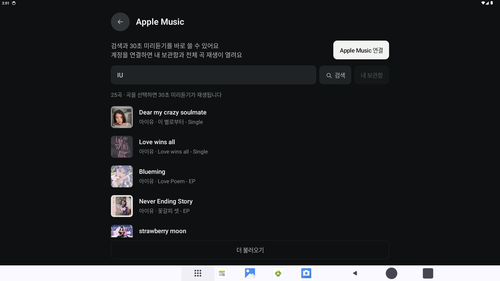

# Apple Music 연동

## 지금 되는 것 (2026-11-14 확인)

개발자 토큰만 설정하면 **로그인 없이** 다음이 동작합니다. 일반 Android 14 에뮬레이터에서 직접 확인했습니다.

- Apple Music 카탈로그 곡 검색(한국 스토어 기준), 실제 앨범 커버 표시
- 곡을 누르면 30초 미리듣기를 앱의 재생 서비스로 재생(하단 재생 바·차량 미디어 세션·알림과 연동)



## 계정 연결과 전체 곡 재생 (2026-11-14 확인)

Android MusicKit SDK 1.1.4(`MediaPlayback-release-1.1.4.aar`, `MusicKitAuth-release-1.1.5.aar`)를 `app/libs/musickit/`에 넣은 `pleosDebug` 빌드로
Pleos Connect 에뮬레이터 v2.1.0(arm64)에서 확인했습니다.

- 계정 연결: "연결됨 · KR" 표시, 내 Apple Music 보관함 25곡 조회
- 전체 곡 재생: 보관함 곡 선택 → 재생 상태 PLAYING, 길이 3:52(미리듣기 30초가 아님), 오류 콜백 없음
- 연결된 상태의 카탈로그 검색

**로그인 방식에 대한 주의.** SDK의 기본 로그인은 기기에 설치된 Apple Music 앱으로 넘어가는 방식이라(Google Play에서 설치 가능해야 함) Pleos에서는 쓸 수 없습니다.
이번 확인은 SDK 문서의 "이미 받은 사용자 토큰 직접 넣기" 경로를 썼습니다. Mac 브라우저에서 MusicKit JS로 로그인해 받은 Music User Token을
**디버그 빌드에서만** 열리는 입력 경로(`am start ... MainActivity --es mut <토큰>`)로 넣었습니다. release 빌드에는 이 경로가 없고, 차량에서 일반 사용자가 로그인하는 방법은 아직 없습니다.

SDK에 맞춰 고친 것: 재생 전에 네이티브 라이브러리(`c++_shared`, `appleMusicSDK`)를 앱이 직접 로드, 오류 콜백 이름 `onPlaybackError`,
토큰 제공자의 `getAppleMusicStoreFrontId`, 외부에서 받은 토큰을 SDK에 알리는 `notifyTokenChanged`, AAR이 요구하는 androidx 의존성, 매니페스트 `allowBackup` 충돌.
재생 라이브러리는 arm64·armv7용만 있어 x86_64 에뮬레이터에서는 전체 곡 재생이 되지 않습니다.

계정이 연결되고 SDK가 있으면 전체 곡을, 그렇지 않으면 미리듣기를 재생하도록 자동으로 나뉩니다.

개발자 토큰은 Apple Developer 계정의 MusicKit 키(.p8)로 서명해 만듭니다. .p8과 토큰은 Git에 올리지 않습니다.
토큰은 최대 6개월짜리이며 APK 안에 들어가므로, 공개 저장소에 올리는 APK에는 넣지 않았습니다.

브랜치: `feat/apple-music-integration`

## 구현한 흐름

- 메인 화면의 **Apple Music** 메뉴 → 계정 연결 → Apple 공식 인증 화면 → 사용자 storefront 확인.
- 계정의 storefront에 맞춘 곡·아티스트 검색, Apple Music 보관함의 곡 조회와 더 불러오기.
- 검색/보관함 목록에서 곡 선택 → 앱 내부 MusicKit 네이티브 플레이어로 전체 곡 재생 요청.
- 기존 `PlaybackService`의 차량 미디어 세션, 하단 재생 바, 알림에서 재생·일시정지·이전·다음·탐색·종료.
- 위치 추천이 갱신되어도 Apple Music 재생 목록과 현재 곡을 유지.
- 연결 해제 시 이 앱에 저장한 사용자 토큰·목록을 지우고 Apple Music 재생 중지.
- 차량 UX 제한 시 계정 연결·검색·목록 선택 차단. 연결 자체로는 음악을 재생하지 않음.

Apple Music의 전체 곡 재생은 활성 구독과 해당 계정/storefront의 재생 권한이 필요합니다.
업로드한 개인 음원 등 Apple Music 카탈로그 ID를 얻을 수 없는 보관함 항목은 재생 불가로 표시합니다.
이 앱의 기존 **보관함**은 시연곡 로컬 즐겨찾기이며, **Apple Music → 내 Apple Music 보관함**과 별개입니다.
지역 시연곡을 임의의 상용 음악으로 매칭하거나 Apple Music 보관함을 변경하지 않습니다.

## 필요한 설정

### 1. 공식 Android SDK

1. [Apple MusicKit](https://developer.apple.com/musickit/) 페이지에서 **Android** 항목으로 이동합니다.
2. **Download the MusicKit SDK for Android**를 누르고 Apple Developer 계정으로 로그인합니다.
   다운로드 목록에서 찾기 어렵다면 [Android MusicKit 검색](https://developer.apple.com/download/all/?q=Android%20MusicKit)을 사용합니다.
3. SDK 압축 파일을 다운로드하여 풉니다. 배포본의 README, API 문서, 샘플도 함께 보관합니다.
4. 인증 및 미디어 재생 AAR과 배포본에서 요구하는 JAR을 `car-app/app/libs/musickit/`에 넣습니다.
5. 배포본 README가 지정한 의존성을 `app/build.gradle.kts`에 추가합니다. 로컬 AAR은 Maven의 전이 의존성을 자동 해결하지 않습니다.
6. 대상 기기 CPU에 맞는 네이티브 라이브러리와 Android 버전 지원을 배포본에서 확인합니다.

SDK는 저장소에 재배포하지 않습니다. `MusicKitBridge.kt`가 이 선택적 바이너리를 런타임에 연결합니다.
인증은 `AuthenticationFactory`/`AuthenticationManager`, 재생은 `MediaPlayerControllerFactory`와
`CatalogPlaybackQueueItemProvider`를 사용하며, 미리듣기 URL이나 외부 앱 이동으로 대체하지 않습니다.
브리지의 메서드 계약은 실제 받은 SDK의 API/샘플과 대조해야 합니다.
현재 SDK 바이너리가 없어 네이티브 API 계약과 Pleos/에뮬레이터 DRM 호환성은 확인하지 않았습니다.
지원되지 않는 SDK API/네이티브 라이브러리에서는 재생 실패를 표시합니다.

### 2. 개발자 토큰

Apple Developer 계정에서 MusicKit Media ID와 Media Services 키를 만들고 서버 또는 신뢰할 수 있는 개발 환경에서
ES256 개발자 JWT를 발급합니다. `.p8` 개인 키를 Android 소스·APK에 넣지 않습니다.

Apple 계정 설정 순서는 다음과 같습니다([공식 안내](https://developer.apple.com/help/account/capabilities/create-a-media-identifier-and-private-key/)).

1. **Certificates, Identifiers & Profiles → Identifiers → + → Media IDs**에서 식별자를 생성하고 MusicKit 서비스를 활성화합니다.
2. **Keys**에서 Media Services 개인 키를 생성하고 해당 Media ID에 연결한 뒤 `.p8` 파일을 안전한 위치에 다운로드합니다.
3. Key ID, Team ID와 개인 키로 개발 환경 또는 서버에서 개발자 JWT를 서명합니다. SDK 파일만 다운로드하는 것으로는 토큰이 만들어지지 않습니다.

이 설정에는 Apple 계정의 Account Holder 또는 Admin 역할이 필요합니다.

Git에서 제외되는 `car-app/local.properties`에 **서명 완료된 JWT만** 설정합니다.

```properties
appleMusic.developerToken=YOUR_SIGNED_DEVELOPER_JWT
```

또는 빌드 프로세스의 `APPLE_MUSIC_DEVELOPER_TOKEN` 환경 변수를 사용합니다. 환경 변수가 우선합니다.
발급한 개발자 토큰은 BuildConfig를 통해 APK에 포함됩니다. 만료 시 새 토큰으로 다시 빌드해야 합니다.
운영 배포에서 재빌드 없이 갱신하려면 별도의 HTTPS 토큰 발급 서버가 필요하며, 이 브랜치에 서버는 포함하지 않습니다.

### 3. 계정 연결

SDK와 토큰을 설정한 앱에서 **Apple Music → Apple Music 연결**을 누릅니다.
사용자는 Apple 공식 인증 화면에서 직접 로그인하고 접근을 허용합니다.
Music User Token은 Android Keystore의 AES-GCM 키로 암호화하여 앱 전용 저장소에 저장합니다.
사용자 토큰을 입력창·로그·소스·외부 콜백 URL에 노출하지 않습니다.
**연결 해제**는 이 앱의 자격 증명을 삭제하며 Apple 계정의 전역 권한 철회를 대신하지 않습니다.

## 코드

| 파일 | 역할 |
|---|---|
| `AppleMusicActivity.kt` | 계정 연결·해제, 검색·보관함·페이지 이동, 차량 UX 제한 |
| `AppleMusicAccount.kt` | 사용자 토큰 암호화 저장, 개발자 토큰 설정·만료 안내 |
| `AppleMusicRepository.kt` | storefront 조회, 카탈로그 검색, 보관함·카탈로그 ID 변환 |
| `MusicKitBridge.kt` | 선택적 공식 인증·네이티브 재생 SDK 바인딩 |
| `PlaybackService.kt` | 시연곡/Apple Music 재생 전환, 차량 세션·재생 큐·알림 |

Apple API 요청은 고정된 `https://api.music.apple.com`에만 보냅니다. 인증 헤더를 다른 호스트로 전달하지 않도록
HTTP 리디렉션을 따르지 않으며, 페이지 이동도 `/v1/` 경로로 제한합니다.
네트워크 요청은 백그라운드에서 수행하고, 연결 해제 전에 시작한 응답은 계정을 다시 연결하거나 목록을 복원하지 못하도록 무효화합니다.

## 이번 작업에서의 확인 범위

사용자 요청에 따라 에뮬레이터 설치·기능 실행·계정 인증·음악 재생·기능 테스트는 수행하지 않았습니다.
SDK와 개발자 토큰이 없는 상태의 Kotlin 컴파일만 수행했습니다.
따라서 컴파일 성공은 Apple SDK의 런타임 연결 또는 실제 전체 곡 재생 성공을 의미하지 않습니다.

## 공식 자료

- [MusicKit 및 Android SDK 다운로드](https://developer.apple.com/musickit/)
- [개발자 토큰 생성](https://developer.apple.com/documentation/applemusicapi/generating-developer-tokens)
- [MusicKit 사용자 인증](https://developer.apple.com/documentation/applemusicapi/user-authentication-for-musickit)
- [Apple Music API](https://developer.apple.com/documentation/applemusicapi)
- [Android 인증 팩토리](https://developer.apple.com/musickit/android/com/apple/android/sdk/authentication/AuthenticationFactory.html)
- [Android 재생 컨트롤러 팩토리](https://developer.apple.com/musickit/android/com/apple/android/music/playback/controller/MediaPlayerControllerFactory.html)
