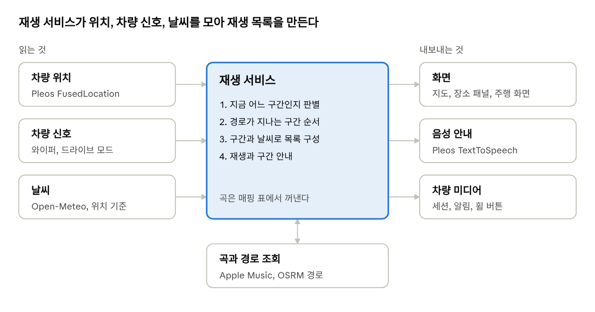

# MoveMe 기술 명세서

2026-11-14 기준 · 원본 문서에서 내보낸 사본입니다.

## 1. 개요

MoveMe은 차가 지나는 구간과 날씨를 읽어 그 길에 정해 둔 곡을 이어 트는 Pleos Connect 차량용 음악 앱입니다. 현대자동차그룹 차량용 앱 개발 공모전 출품작이며, 이 문서는 2026-11-14 main 브랜치(`294a6c3`) 기준입니다.

| 항목 | 값 |
|----|----|
| 저장소 | `Re-Melody/dodori-music`, 앱은 `car-app/` |
| 패키지 / 버전 | `com.musicmap.car` / 0.2.0 |
| 대상 플랫폼 | Pleos Connect v2.1.0 (Android Automotive, API 34), 최소 API 28 |
| 언어와 UI | Kotlin, Android View를 코드로 직접 구성 (Compose와 XML 레이아웃 없음) |
| 규모 | Kotlin 약 6,000줄 (테스트 포함) |
| 서버 | 없음. 모든 상태는 기기 안에 저장 |
| 빌드 변형 | pleos (차량용, Pleos SDK 포함), standard (일반 Android) |

핵심 설계 원칙은 하나입니다. 구간과 곡의 짝은 앱 안의 표에 미리 적어 두고, 주행 중에는 "지금 어느 구간인가"만 계산합니다. 주행 중에 문장이나 곡을 생성하지 않으며 LLM을 호출하지 않습니다.

## 2. 기능 명세

기획서의 다섯 기능 중 네 개를 구현했고, 공유 기능(⑤)은 서버가 정해지지 않아 만들지 않았습니다.

| 기능 | 동작 | 상태 |
|----|----|----|
| ① 경로 기반 드라이브 트랙 | 목적지를 고르면 도로 경로를 받아, 그 길이 지나는 구간을 주행 순서로 찾고 구간마다 정해 둔 곡을 이어 붙인다. 구간에 들어서면 다음 곡들이 그 구간의 곡으로 바뀌고, 듣던 곡은 끊지 않는다 | 구현 |
| ② 날씨에 맞춘 선곡 | 차의 위치로 현재 날씨를 조회해 곡 순서를 바꾸고, 날씨에 맞는 곡을 한두 곡 끼워 넣는다. 와이퍼가 켜져 있으면 예보와 상관없이 비로 본다. 기획서의 "정체 감지" 안을 이 안으로 바꿨다 | 구현 |
| ③ 구간 진입 한 줄 안내 | 새 구간에 들어서거나 분위기가 바뀌면 한 문장을 음성으로 말하고 같은 문장을 화면 자막으로 8초간 띄운다. 말하는 동안 음악 음량을 낮춘다. 스피커 버튼으로 끌 수 있다 | 구현 |
| ④ 나만의 트랙 편집 | 지금 있는 구간에 Apple Music의 곡을 골라 지정하면 그 구간의 첫 곡이 된다. 정차 중에만 할 수 있다. 주행 중 조작은 스티어링 휠 미디어 버튼까지만 지원하고, 음성 명령은 없다 | 일부 구현 |
| ⑤ 다른 사용자와 트랙 공유 | 같은 길을 지난 사람의 트랙 불러오기, 구간별 인기 곡 | 미구현 (10장 참고) |

기획 기능 외에 다음이 들어 있습니다.

- **주행 화면**: 차량이 주행 제한을 알리면 목록과 지도 조작을 치우고 커버, 구간 이름, 곡 제목, 재생 버튼 3개만 크게 남긴다.

- **Apple Music**: 로그인 없이 카탈로그 검색과 30초 미리듣기. 계정을 연결하면 내 보관함 조회와 전체 곡 재생.

- **경로 이탈 대응**: 실제 주행에서 계획한 길에서 1.5km 넘게 벗어나면 남은 길의 트랙을 다시 만든다 (30초에 한 번까지).

- **경로 둘러보기**: 실제로 달리지 않고 경로를 따라 가상으로 이동하며 동작을 보는 시연 모드.

- **보관함**: 내장 곡을 기기에 저장.

- **차량 미디어 연동**: MediaBrowserService와 MediaSession으로 시스템 미디어 화면, 알림, 스티어링 휠 버튼에서 재생 제어.

## 3. 구조

재생 서비스 하나가 위치, 날씨, 차량 신호를 모아 재생 목록을 만들고, 화면은 그 상태를 그리기만 합니다. 화면이 서비스에 보내는 것은 명령(인텐트 액션)뿐이고, 서비스가 상태(`AppState`)를 바꾸면 화면이 다시 그려집니다.



왼쪽 세 가지를 읽어 가운데 서비스가 목록을 만들고, 오른쪽 세 곳으로 내보냅니다. 곡 정보와 도로 경로만 밖에서 가져옵니다.

| 파일 | 역할 |
|----|----|
| `PlaybackService.kt` | 재생, 미디어 세션과 알림, 위치 수신, 목적지 계획, 재생 목록 구성, 음성 안내 |
| `Catalog.kt` | 구간과 곡의 매핑 표, 구간 판별, 날씨와 차량 신호를 분위기로 바꾸는 규칙 |
| `Route.kt` | 경로 기하: 길이, 경로 위의 점, 경로까지 거리, 경로가 지나는 구간 순서. 모두 순수 함수 |
| `DriveData.kt` | 날씨 조회, 도로 경로 조회, 구간별 내 곡 저장 |
| `AppleMusicRepository.kt`, `AppleMusicAccount.kt` | Apple Music API 호출, 구간과 날씨에 맞는 곡 불러오기, 사용자 토큰 암호화 저장 |
| `MusicKitBridge.kt` | Apple의 Android용 MusicKit SDK 연결 (전체 곡 재생). SDK 파일이 없어도 빌드됨 |
| `PositionSource.kt`, `Drive.kt` | 위치, 차량 신호, 음성 안내의 인터페이스와 일반 Android 구현 |
| `src/pleos/.../PositionFactory.kt`, `DriveFactory.kt` | Pleos SDK 구현 (FusedLocation, Vehicle, TextToSpeech) |
| `MainActivity.kt` | 메인 화면: 차량 가로 화면, 주행 화면, 세로 화면 |
| `AppleMusicActivity.kt` | Apple Music 검색과 보관함, 계정 연결, 구간에 곡 지정 |
| `MusicMapView.kt` | 지도: 타일, 경로선, 구간 핀, 현재 위치 |
| `DesignSystem.kt`, `UiKit.kt` | 색과 아이콘, 구간별 커버 그림, 화면 공용 부품 |
| `CarUxGuard.kt` | 차량의 주행 제한(`CarUxRestrictions`) 수신 |
| `MusicMapApplication.kt` | 앱 전체가 공유하는 상태 `AppState` |

플랫폼에 따라 달라지는 부분(위치, 차량 신호, 음성)은 인터페이스 뒤에 두고 빌드 변형별 소스 폴더에서 구현을 고릅니다. 그래서 공통 로직은 일반 Android 에뮬레이터에서도 그대로 돕니다.

## 4. 데이터 모델과 매핑 표

구간(`MusicRegion`)은 중심 좌표와 반경으로 정의한 원이고, 구간마다 안내 문장과 곡이 적혀 있습니다. 현재 등록된 구간은 5곳입니다.

| 구간 | 종류 | 중심 좌표 (위도, 경도) | 반경 | 정해 둔 곡 (Apple Music 한국 카탈로그 ID) | 검색어 | 내장 곡 |
|----|----|----|----|----|----|----|
| 서울 · 한강 seoul | 랜드마크 | 37.525, 126.938 | 12km | 후디 「한강」 (1610730837) | 한강 | 강변의 오후, 도시의 불빛 |
| 수원 · 화성 suwon | 랜드마크 | 37.286, 127.012 | 8km | 노브레인 「나의 사랑 나의 수원」 (1477149763) | 수원 | 성곽을 따라서, 새로운 길 |
| 용인 · 호수 yongin | 랜드마크 | 37.241, 127.177 | 10km | 김사월 「호수」 (1735701751) | 호수 | 호수의 바람, 숲으로 가는 길 |
| 강남대로 gangnam | 도로 | 37.4979, 127.0276 | 1.5km | 싸이 「강남스타일」 (1339074799) | 없음 | 없음 |
| 동탄지성로 jisung | 도로 | 37.2252, 127.0486 | 1.2km | 윤혜진과 브라더스 「위송빠레」 (1522374158), Five Sense 「박지성을 위한 노래」 (1705661056) | 없음 | 없음 |

- 좌표는 OpenStreetMap에서, 곡 ID는 Apple Music 한국 카탈로그에서 표를 만들 때 한 번 조회한 값입니다.

- 랜드마크는 정해 둔 곡 뒤에 검색어로 찾은 상위 곡을 더해 최대 6곡을 가집니다. 도로는 검색어가 없어 정해 둔 곡만 나옵니다. 검색 결과에 관련 없는 곡이 섞이는 것을 막기 위해서입니다.

- 내장 곡 6개는 직접 합성한 24초 시연용 음원이며 네트워크 없이 재생됩니다. 각각 "차분하게" 또는 "경쾌하게"로 분류돼 있어 분위기에 따라 순서가 바뀝니다.

- 구간을 늘리려면 `Catalog.kt`의 regions 또는 roads에 한 줄을 더하면 됩니다.

곡(Track)은 출처가 어디든 같은 모델을 씁니다.

| 필드 | 뜻 |
|----|----|
| id | 내장 곡은 짧은 이름(river), Apple Music 곡은 `apple:<카탈로그 ID>` |
| regionId | 속한 구간. 날씨 추천 곡은 weather, 검색에서 고른 곡은 apple-music |
| genre | 차분하게, 경쾌하게, 인기곡, 오늘 날씨, 내가 지정한 곡 중 하나 |
| asset | 내장 음원 파일 이름 |
| appleMusicId, previewUrl, artworkUrl | 전체 곡 재생용 ID, 30초 미리듣기 주소, 앨범 커버 주소 |

기기에 저장하는 값은 네 가지입니다: 보관함, 음성 안내 켜짐 여부, 구간별 내 곡, 암호화한 Apple Music 사용자 토큰.

## 5. 핵심 로직

### 5.1 구간 판별 (`Catalog.detect`)

위치가 올 때마다 차가 어느 구간 안에 있는지 정합니다.

1.  위치가 반경 안에 들어가는 구간을 모두 찾는다.

2.  그중 도로를 랜드마크보다 우선하고, 같은 종류끼리는 중심이 가까운 쪽을 고른다.

3.  직전 구간의 가장자리를 조금 넘어선 정도라면 직전 구간을 유지한다. 여유는 반경의 25%이고 최대 1km다. GPS가 경계에서 흔들려 음악이 오락가락하는 것을 막는다.

4.  단, 랜드마크 안에 있다가 도로 구간에 들어서면 여유와 상관없이 도로로 바꾼다.

### 5.2 목적지에서 드라이브 트랙까지 (`PlaybackService.planTo`, `Route.plan`)

1.  출발점은 현재 위치이고, 위치가 없으면 서울 한강이다.

2.  경로 서버에서 출발점부터 목적지까지의 도로 경로를 점의 나열로 받는다. 실패하면 두 점을 잇는 직선을 쓴다.

3.  경로를 400등분한 점을 앞에서부터 훑으며, 구간마다 경로가 처음 반경 안에 들어오는 지점을 찾는다.

4.  그 지점이 있는 구간만 진입 순서대로 나열한 것이 드라이브 트랙의 구간 목록이다.

5.  실제 주행 중 위치가 경로에서 1.5km 넘게 떨어지면 현재 위치에서 같은 목적지로 다시 계획한다 (30초에 한 번까지).

### 5.3 재생 목록 구성 (`PlaybackService.refreshRecommendations`)

구간이 바뀌거나, 분위기가 바뀌거나, 곡 정보가 도착할 때마다 목록을 다시 만듭니다.

1.  **한 구간의 곡**은 내가 지정한 곡, 카탈로그 곡, 내장 곡 순서로 합친다. 내장 곡은 현재 분위기와 같은 분류가 앞에 온다.

2.  **지금 구간**에서는 목적지가 있으면 3곡, 없으면 8곡까지 넣는다.

3.  **날씨 곡**은 지금 구간의 앞 2곡 바로 뒤에 끼운다 (목적지가 있으면 1곡, 없으면 2곡).

4.  **앞으로 지날 구간**은 아직 지나지 않은 구간마다 1곡씩 주행 순서로 붙인다.

5.  재생 중인 곡은 그대로 두고, 그 뒤에 이어질 곡만 새 목록으로 바꾼다.

카탈로그 곡은 구간당 한 번만 불러와 앱이 켜져 있는 동안 기억합니다. 개발자 토큰이 없거나 네트워크가 끊기면 내장 곡만으로 목록이 만들어집니다.

### 5.4 분위기 규칙 (`DriveContext`)

날씨, 와이퍼, 드라이브 모드를 하나의 분위기로 바꿉니다. 위에서부터 먼저 맞는 규칙을 씁니다.

| 조건 | 분위기 | 화면 문구 | 날씨 곡 검색어 |
|----|----|----|----|
| 와이퍼 켜짐 또는 날씨가 비 | 차분하게 | 비 오는 길 · 차분한 곡부터 | 비 오는 날 |
| 눈 | 차분하게 | 눈 오는 길 · 차분한 곡부터 | 눈 오는 날 |
| 안개 | 차분하게 | 안개 낀 길 · 차분한 곡부터 | 없음 |
| 스포츠 모드 | 경쾌하게 | 스포츠 모드 · 경쾌한 곡부터 | 날씨에 따름 |
| 에코 모드 | 차분하게 | 에코 모드 · 차분한 곡부터 | 날씨에 따름 |
| 맑음, 낮 | 경쾌하게 | 맑은 날 · 경쾌한 곡부터 | 드라이브 |
| 맑음, 밤 | 차분하게 | 맑은 밤 · 차분한 곡부터 | 밤 드라이브 |
| 흐림 또는 날씨 정보 없음 | 없음 (순서 유지) | 없음 | 없음 |

날씨는 10분이 지났거나 15km 이상 이동했을 때만 다시 조회합니다. 분위기가 바뀌면 한 문장으로 알리되, 다른 안내가 나가는 중이면 끝날 때까지 기다립니다.

### 5.5 매초 하는 일

서비스는 1초마다 깨어나지만, 위치나 재생 위치가 실제로 바뀐 초에만 화면을 갱신합니다. 미디어 세션 상태는 10초에 한 번, 알림은 내용이 바뀌 때만 다시 보냅니다. 이렇게 바꾸기 전후로 재생 중 30초간 앱 CPU 시간이 274틱에서 43틱으로 줄었습니다 (일반 Android 에뮬레이터, 각 1회 측정).

## 6. 외부 연동

앱이 의존하는 외부 요소는 Pleos SDK 3종, Apple Music, 공개 서비스 3곳입니다. 어느 것이 실패해도 앱은 멈추지 않고 가진 것으로 계속 동작합니다.

### 6.1 Pleos Connect SDK (pleos 변형에만 포함)

| SDK | 버전 | 쓰는 곳 | 권한 |
|----|----|----|----|
| FusedLocation | 1.1.3 | 차량 위치 수신 | `pleos.car.permission.FUSED_LOCATION` + Android 위치 권한 |
| Vehicle | 2.3.2 | 앞 유리 와이퍼 상태, 드라이브 모드 | `pleos.car.permission.CAR_DRIVE`, `CAR_WINDOWS` |
| TextToSpeech | 3.3.1 | 구간 안내 음성 (온디바이스 모드) | `pleos.car.permission.TTS_SERVICE` |

- Maven 저장소: `https://nexus-playground.pleos.ai/repository/maven-releases/`

- TextToSpeech는 `initialize()`가 끝난 뒤에 리스너를 등록해야 하고, 로케일은 `ko-KR`이어야 합니다. ko만 주면 엔진이 오류를 냅니다. 초기화에 실패하면 Android 기본 음성 엔진으로 넘어갑니다.

- Vehicle의 드라이브 모드는 Pleos 에뮬레이터가 지원하지 않는 속성이라 실패 응답을 받고 무시합니다.

- 주행 제한은 Android Automotive의 `CarUxRestrictions`로 받습니다. 상태를 알 수 없으면 제한된 것으로 봅니다. 메인 화면은 `distractionOptimized`를 선언했습니다.

### 6.2 Apple Music

| 단계 | 되는 것 | 필요한 것 |
|----|----|----|
| 개발자 토큰만 | 카탈로그 검색, 앨범 커버, 30초 미리듣기, 구간과 날씨 곡 | MusicKit 키(.p8)로 서명한 개발자 JWT |
| 계정 연결 | 내 보관함 조회, 전체 곡 재생 | 위 + Music User Token + MusicKit Android SDK 1.1.4 + Apple Music 구독 |

- API 호출은 `https://api.music.apple.com` 한 곳으로만 보내고 리디렉션을 따르지 않습니다.

- 개발자 토큰은 `car-app/local.properties`의 `appleMusic.developerToken`에 넣으면 빌드할 때 앱에 들어갑니다. 현재 토큰은 2027-05-03에 만료됩니다.

- SDK 파일(AAR 2개)은 Git에 올리지 않고 `car-app/app/libs/musickit/`에 직접 넣습니다. 없어도 빌드되며, 그때는 미리듣기로 재생합니다.

- SDK의 재생 라이브러리는 arm64와 armv7용만 있습니다. x86_64 에뮬레이터에서는 전체 곡 재생이 안 됩니다.

- **차 안에서 로그인하는 방법은 아직 없습니다.** SDK의 기본 로그인은 Google Play의 Apple Music 앱으로 넘어가는 방식이라 Pleos에서는 쓸 수 없습니다. 지금은 디버그 빌드에만 있는 경로로, 웹에서 받은 사용자 토큰을 직접 넣어 확인했습니다.

- 사용자 토큰은 Android Keystore의 AES-GCM 키로 암호화해 앱 전용 저장소에 둡니다.

### 6.3 공개 서비스

| 서비스 | 용도 | 보내는 것 | 실패하면 |
|----|----|----|----|
| OSRM 공개 서버 `router.project-osrm.org` | 목적지까지 도로 경로 | 출발과 도착 좌표 | 두 점을 잇는 직선으로 계산 |
| Open-Meteo `api.open-meteo.com` | 현재 날씨 | 약 1km 단위로 반올림한 좌표 | 날씨 없이 동작 (순서 유지) |
| OpenStreetMap 타일 `tile.openstreetmap.org` | 지도 배경 | 타일 번호 | 배경 없이 경로와 핀만 표시 |

세 서비스 모두 키 없이 쓰는 공개 서버이고 시연용입니다. 출시하려면 경로는 차량 내비게이션(NaviHelper SDK) 연동이나 자체 서버로, 지도 타일은 계약된 제공자로 바꿔야 합니다.

## 7. 화면

화면은 가로 폭에 따라 세 가지 배치 중 하나로 그려집니다. 가로 폭이 840dp 이상이고 가로가 더 길면 차량 배치를 씁니다.

| 배치 | 언제 | 구성 |
|----|----|----|
| 차량 가로 화면 | 차량 화면, 정차 중 | 지도가 화면 전체를 채우고 왼쪽에 장소 패널, 아래에 재생 바가 뜬다. 패널: 탭, 지금 지나는 곳, 목적지 버튼과 내 곡 지정 버튼, 곡 목록, 현재 위치와 경로 둘러보기 버튼 |
| 주행 화면 | 차량 화면, 주행 제한 중 | 패널과 재생 바를 치우고 아래에 큰 띠 하나: 커버, 구간 이름, 곡 제목, 이전·재생·다음 버튼. 목록과 글자 입력이 없다 |
| 세로 화면 | 휴대폰 등 좋은 화면 | 장소 머리글, 지도 카드, 곡 목록을 세로로 쌓고 아래에 미니 플레이어와 탭 |

디자인 규칙은 네 가지입니다.

- **색**: 배경과 글자는 그래파이트 무채색. 강조색은 차선 노란색(`#F2B84B`) 하나로, 재생 버튼과 재생 중인 곡에만 쓴다. 구간마다 고유 색이 있지만 지도 핀과 커버 그림에만 쓴다.

- **크기**: 화면의 짧은 변 길이에 따라 글자와 간격 전체를 1배에서 1.5배까지 키운다. 간격은 4 단위 격자, 버튼 높이는 48 이상.

- **커버**: 재생되는 곳에는 항상 커버를 보여 준다. Apple Music 곡은 실제 앨범 커버, 내장 곡은 구간을 선으로 그린 그림(강물결, 성곽, 호수 물결). 시스템 미디어 화면과 알림에도 같은 커버를 넘긴다.

- **경로선**: 지도의 경로와 제목 아래 짧은 선을 차선처럼 점선으로 그린다. 이 앱만의 표식으로 이 두 곳에만 쓴다.

정차 중에만 할 수 있는 조작은 목적지 고르기, 내 곡 지정, 곡 목록 선택, 지도 확대·축소, Apple Music 검색과 계정 연결입니다.

## 8. 빌드와 실행

JDK 17 이상과 Android SDK 34가 있으면 car-app 폴더에서 바로 빌드됩니다.

```bash
cd car-app
./gradlew :app:assemblePleosDebug # 차량용
./gradlew :app:assembleStandardDebug # 일반 Android
./gradlew :app:testStandardDebugUnitTest # 단위 테스트
./gradlew :app:assemblePleosRelease # 제출용 (서명 설정 필요)
```

`car-app/local.properties`에 적는 값입니다. 이 파일은 Git에 올라가지 않습니다.

| 키 | 용도 | 없으면 |
|----|----|----|
| `sdk.dir` | Android SDK 경로 | 빌드 실패 |
| `appleMusic.developerToken` | Apple Music 개발자 JWT | Apple Music 기능이 꺼지고 내장 곡만 재생 |
| `release.storeFile`, `release.storePassword`, `release.keyAlias`, `release.keyPassword` | release 서명 | release APK가 서명되지 않음 |

Pleos Connect 에뮬레이터 설정입니다.

| 항목 | 값 |
|----|----|
| 이미지 | Pleos Connect v2.1.0, API 34. Mac은 arm64, Windows와 Linux는 x86_64 |
| 화면 | 2560×1440, 160dpi. 앱 창은 1682×1210dp |
| 메모리와 부팅 | RAM 4GB, Cold boot |
| 사용자 | 현재 사용자 ID가 10이라 설치 후 권한 부여와 실행에 `--user 10`을 붙인다 |
| Mac에서의 주의 | 기본 그래픽 모드로는 부팅 직후 멈춰서 `-gpu swiftshader_indirect`로 실행했다. 느리고 CPU를 많이 쓴다 |

제출용 APK는 저장소의 `apk/ReMelody_MoveMe_release.apk`입니다. Apple Music 개발자 토큰을 넣지 않고 빌드했기 때문에, 이 APK에서는 Apple Music 기능이 꺼지고 내장 곡만 재생됩니다.

디버그 빌드에만 있는 시연용 입력입니다.

| 명령 | 하는 일 |
|----|----|
| `am start ... MainActivity --ez drive true` | 주행 화면을 바로 띄운다 |
| `am start-foreground-service ... -a sim_rain --ez on true` | 와이퍼가 켜진 것처럼 만든다 |
| `am start-foreground-service ... -a sim_mode --es value SPORT` | 드라이브 모드를 바꾼다 |
| `am start ... MainActivity --es mut <토큰>` | 웹에서 받은 Apple Music 사용자 토큰을 넣는다 |

## 9. 검증 현황

자동 검사는 모두 통과했고, 주요 흐름은 에뮬레이터에서 직접 실행해 확인했습니다. 실제 차량에서는 한 번도 돌리지 않았습니다.

| 항목 | 결과 |
|----|----|
| 빌드 | `standardDebug`, `pleosDebug`, `pleosRelease` 성공. release APK 서명 확인 |
| 단위 테스트 | 12개 통과: 구간 판별, 경계 여유, 도로 우선, 경로 기하, 경로를 구간 순서로 자르기, 분위기 규칙, 재생 목록 유지 |
| lint | 오류 0개 (두 변형) |

에뮬레이터에서 직접 확인한 것입니다.

| 기능 | 일반 Android 14 (1920×1080) | Pleos Connect v2.1.0 |
|----|----|----|
| 실행, 화면 배치, 충돌 없음 | 확인 | 확인 (드라이브 트랙 추가 전 버전) |
| 목적지 → 도로 경로 → 구간 순서 트랙 | 확인 | 미확인 |
| 도로 구간에서 정해 둔 곡 재생 (동탄지성로 → 「위송빠레」) | 확인 | 미확인 |
| 날씨 조회 | 확인 (받은 값이 같은 시각 서비스 응답과 일치) | 미확인 |
| 비 상황의 문구와 날씨 곡 | 확인 (디버그 신호로) | 미확인 |
| 구간에 내 곡 지정 | 확인 | 미확인 |
| 주행 화면과 커버 | 확인 (디버그 옵션으로) | 미확인 |
| 음성 안내 | 자막만 확인 (음성 엔진 없음) | 시작과 완료 콜백 확인, 소리는 직접 듣지 못함 |
| 와이퍼 상태 수신 | 해당 없음 | 값 수신 확인, 켰을 때의 반응은 미확인 |
| Apple Music 검색과 미리듣기 | 확인 | 확인 |
| Apple Music 계정 연결과 전체 곡 재생 | 미확인 | 확인 (보관함 곡, 3분 52초 길이) |

확인하지 못한 것입니다.

- Pleos 에뮬레이터에서 드라이브 트랙, 날씨, 내 곡 지정. 이 기능들을 넣은 뒤에는 Pleos에서 다시 돌리지 않았습니다.

- 기어를 D로 놓았을 때 주행 화면으로 바뀌는지.

- 실제 주행에서의 경로 이탈 재계획. 거리 계산만 테스트했습니다.

- 맑음, 눈, 안개 날씨에서의 실제 화면. 측정 시각의 날씨가 흐림이었습니다.

- 검색 결과에서 고른 곡의 전체 재생 (보관함 곡으로만 확인).

- 기존 계측 테스트(`SmokeInstrumentation`, `VehicleQa`)는 화면 개편 이후 다시 실행하지 않았습니다.

- Pleos 미디어 센터 노출, 스티어링 휠 버튼, 차량 절전과 재개, 실제 차량.

## 10. 결정이 필요한 것

공유 기능(⑤)은 어떤 서버를 쓸지 정해져야 시작할 수 있습니다. 지금 앱에는 서버가 없고, 다른 사용자의 트랙이나 구간별 인기 곡을 저장할 곳이 없습니다.

### 10.1 공유 기능의 서버 (결정 필요)

| 선택지 | 장점 | 부담 |
|----|----|----|
| 도도리 본 서비스의 Firebase 프로젝트를 같이 쓴다 | 계정과 운영 환경이 이미 있다. 도도리 사용자와 이어진다는 사업성 근거가 된다 | 본 서비스 데이터와 보안 규칙에 영향을 준다. 규칙 변경과 배포가 필요하다 |
| 이 앱 전용 Firebase 프로젝트를 새로 만든다 | 본 서비스와 분리돼 안전하다 | 프로젝트 생성, 설정 파일, 규칙을 처음부터 만든다 |
| 이번 제출에서는 빼고 기획서에 계획으로만 적는다 | 마감 전에 할 일이 없다 | 시연에서 공유 기능을 보여 줄 수 없다 |

어느 쪽이든 함께 정해야 하는 것이 있습니다.

- 사용자를 어떻게 구분할지 (익명 계정으로 충분한지, 로그인이 필요한지).

- 무엇을 올릴지. 최소한은 "구간 ID, 곡 ID, 지정한 사람"이고, 주행 경로나 시각까지 올리면 위치 기록이 되어 개인정보 고지가 필요합니다.

- 인기 곡을 어떻게 셈지 (지정 횟수인지, 재생 횟수인지).

- 시연용 데이터. 실제 사용자가 만든 것이 아닌 가짜 인기 곡으로 채우는 방식은 넣지 않았습니다.

### 10.2 제출 전에 정할 것

접수 마감은 2026-11-15 23:59이고, 저장소는 11-16부터 11-23까지 공개해야 가산점을 받습니다.

| 결정 | 내용 |
|----|----|
| 제출 APK에 Apple Music 토큰을 넣을지 | 넣으면 심사위원이 구간 곡과 검색을 볼 수 있다. 공개 저장소라 누구나 토큰을 꺼낼 수 있다 (만료 2027-05-03) |
| 옛 브랜치 5개 삭제 | 다른 앱을 디컴파일한 코드가 들어 있어 공개 전에 지워야 한다. 대상: `analysis/wayvibe`, `feat/apple-music-integration`, `feat/dark-vehicle-design`, `feat/portrait-music-app`, `fix/vehicle-playback-qa` |
| 팀명 | APK 파일명에 ReMelody로 적었다. 접수 양식의 팀명과 같아야 한다 |
| release 서명 키 보관 | 키와 비밀번호가 빌드한 Mac 한 대에만 있다. 잃으면 같은 서명으로 업데이트할 수 없다 |

## 11. 알려진 한계와 남은 작업

지금 버전은 시연용 프로토타입이고, 아래는 알고 있는 빈 곳입니다.

| 한계 | 현재 | 풀려면 |
|----|----|----|
| 목적지 | 매핑된 5곳 중에서만 고른다 | 주소 검색 또는 차량 내비게이션(NaviHelper SDK)의 목적지 연동 |
| 구간 수 | 5곳. 원으로 근사한 영역 | 표에 구간 추가. 도로는 선 형태로 정의하면 더 정확하다 |
| "그 지역 출신 가수의 곡" | 넣지 않았다. 출신지를 확인한 근거가 있어야 한다 | 출처를 확인한 뒤 표에 추가 |
| 구간의 곡 | 랜드마크의 추가 곡은 장소 이름으로 검색한 상위 곡이다. 그 지역에서 실제로 많이 듣는 곡이 아니다 | 사용자 재생 기록 집계 (공유 기능의 서버 필요) |
| 주행 중 조작 | 스티어링 휠 미디어 버튼까지. 음성 명령 없음 | SpeechToText SDK 또는 Gleo 연동 |
| Apple Music 로그인 | 차 안에서 할 수 없다. 디버그 경로만 있다 | 휴대폰에서 로그인해 차로 넘기는 흐름 설계 |
| 미디어 센터 | `MediaLibraryService` 미선언. Pleos 기본 미디어 화면에 안 뜰 수 있다 | Media3 `MediaLibraryService`로 전환 |
| 경로와 날씨 | 공개 서버에 의존한다 | 내비게이션 연동, 계약된 날씨·지도 제공자 |
| 내장 곡 | 직접 합성한 24초 시연 음원 6개 | 음원 공급 계약 |
| 정체 감지 | 기획서의 초기 안. 날씨로 바꾸면서 만들지 않았다 | 필요하면 Vehicle SDK의 속도와 내비게이션 도착 시간으로 추가 |

다음에 할 일은 세 가지입니다.

- [ ] Pleos 에뮬레이터에서 드라이브 트랙, 날씨, 내 곡 지정, 기어 D에서의 주행 화면을 확인한다
- [ ] 기존 계측 테스트(`vehicle_qa.py`)를 다시 돌린다
- [ ] 10장의 결정을 내리고 기획서에 반영한다
