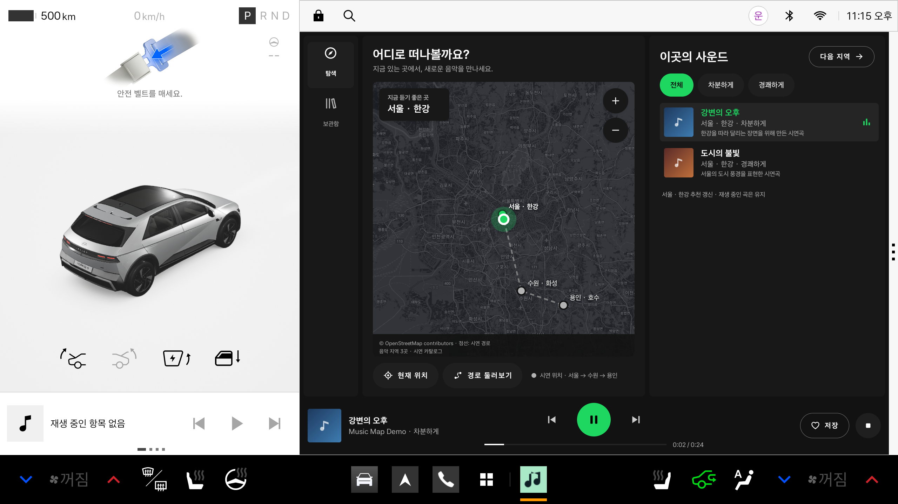
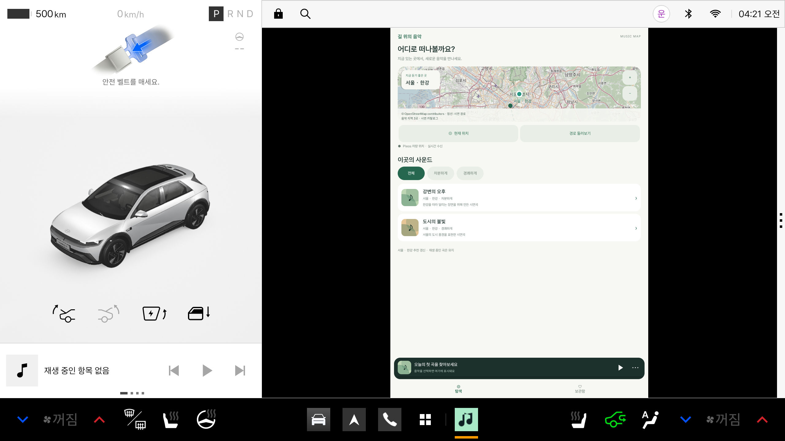
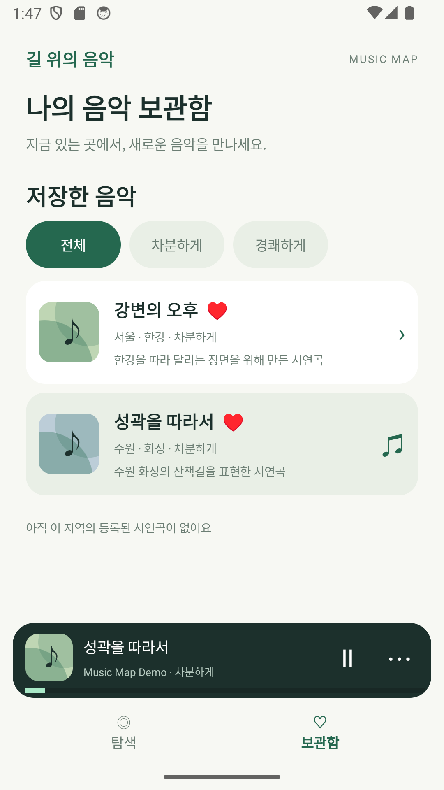

# 검증 기록

## 2026-11-14 매초 작업량 줄이기 (KST)

재생 서비스가 1초마다 화면 전체 갱신, 미디어 세션 상태 전송, 알림 재게시를 하고 있었고, 아무것도 재생하지 않을 때도 계속 돌았습니다.

- 서비스: 위치나 재생 위치가 실제로 바뀐 초에만 화면에 알림. 세션 상태는 10초에 한 번(세션이 위치를 스스로 계산함), 알림은 내용이 바뀔 때만 다시 게시.
- 화면: 바뀐 항목만 다시 적용(지도, 필터 칩, 탭, 조작 잠금, 글자). 재생 시계는 고정 폭으로 두어 매초 전체 레이아웃이 다시 돌지 않게 함.
- 지도: 타일 캐시 64 → 192장. 2560×1440 화면은 한 번에 약 80장을 그려서, 기존 크기로는 보이는 타일이 계속 밀려나 다시 내려받는 순환이 생깁니다.

측정(일반 Android 14 에뮬레이터 1920×1080, 경로 둘러보기 + 재생 중 30초, 각 1회):

| | 앱 CPU 시간 (30초) | 그린 프레임 수 (30초) |
| --- | --- | --- |
| 변경 전 | 274틱 (코어 하나의 약 9%) | 194 |
| 변경 후 | 43틱 (약 1%) | 37 |

아무것도 재생하지 않는 20초 동안의 CPU 시간은 0틱이었습니다. 측정은 한 번씩이고 변경 전 측정이 부팅 직후 첫 실행이라 지도 타일 내려받기가 일부 섞였을 수 있습니다. Pleos 에뮬레이터에서는 다시 재지 않았습니다.

## 2026-11-14 화면 개편 · 차량 신호 · 음성 안내 (KST)

확인한 것 (macOS, JDK 25, Android SDK 34):

- `assembleStandardDebug`, `assemblePleosDebug`, `assemblePleosRelease` 성공. release APK 서명 확인(`apksigner verify`).
- `testStandardDebugUnitTest` 7개 통과(주행 분위기에 따른 추천 순서 검사 1개 추가).
- `lintStandardDebug`, `lintPleosDebug` 오류 0개.
- 일반 Android 14 에뮬레이터(1920×1080, 160dpi, 가로)에서 `standard` 변형으로 직접 실행:
  경로 둘러보기 → 재생 → 다음 지역, 지역 진입 자막, 비 오는 구간의 추천 순서 변경, 보관함, Apple Music 화면, 주행 화면(디버그 전용 `--ez drive true`), 세로 화면(1080×1920, 420dpi). 충돌 기록 없음.

- Apple Music: 개발자 토큰으로 카탈로그 검색(25곡), 앨범 커버 표시, 30초 미리듣기 재생(재생 상태 PLAYING, 0:30 길이) 확인. 로그인·전체 곡 재생은 미검증.

Pleos Connect 에뮬레이터 v2.1.0 (macOS arm64 이미지, 2560×1440 / 160dpi, 소프트웨어 그래픽, 사용자 10)에서 `pleosDebug`로 확인한 것:

- 앱 실행과 가로 화면 배치(장소 패널·재생 바·지도), 충돌 없음.
- 권한 `FUSED_LOCATION`, `CAR_DRIVE`, `CAR_WINDOWS`, `TTS_SERVICE` 부여 성공(`pm grant`).
- Vehicle SDK: 서비스 연결, 앞 유리 와이퍼 상태 조회 응답 수신(`WINDSHIELD_WIPERS_STATE`), 리스너 등록. 드라이브 모드는 이 에뮬레이터가 지원하지 않는 속성이라 실패 응답을 받고 무시함(앱 동작에는 영향 없음).
- TextToSpeech SDK(온디바이스): 지역 진입 문장을 요청해 `onStart` → `onDone` 콜백 수신. 로그 기준이며 스피커 소리는 직접 듣지 못했습니다.
  이 과정에서 두 가지를 고쳤습니다: `initialize()` 뒤에 리스너를 등록해야 함, 로케일은 `ko-KR`이어야 함(`ko`만 주면 엔진 오류).
- 경로 둘러보기 → 재생: 서울 한강 진입 시 Apple Music의 장소 인기곡 8곡 + 내장 2곡이 목록에 뜨고 첫 곡 미리듣기 재생(PLAYING).

아직 확인하지 못한 것:

- 실제 주행 상태(기어 D)에서의 주행 화면 전환. 주행 화면 자체는 일반 에뮬레이터에서 디버그 옵션으로만 확인했습니다.
- 와이퍼를 실제로 켰을 때의 추천 순서 변경(값 수신까지만 확인), Pleos에서의 실시간 위치 수신 재확인(2026-11-10 기록 참고).
- 하드웨어 그래픽 모드: 이 Mac에서는 에뮬레이터가 부팅 직후 멈춰 소프트웨어 그래픽(`-gpu swiftshader_indirect`)으로 실행했습니다.
- 기존 계측 테스트(`SmokeInstrumentation`, `VehicleQa`)는 이번 변경 뒤 다시 실행하지 않았습니다.
- 시작 직후 에뮬레이터에서 프레임 끊김이 관찰됐습니다. 앱 메인 스레드는 대기 상태였고 소프트웨어 GPU와 호스트 부하의 영향으로 보이나, 실기기에서 재확인이 필요합니다.

## 2026-11-10 다크 디자인·차량 가로 화면 (KST)

- 프로젝트 `Design,md`의 규칙(다크 무채색 표면, 단일 기능 액센트, 필·원형 버튼, 8 단위 간격, 700/400 굵기)으로 화면을 재구성했다.
- 세로 고정을 해제했다. Pleos 앱 창 1682×1210dp에서 내비 레일·지도·목록·하단 재생 바가 검은 여백 없이 창을 채운다.
- 차량 화면은 짧은 변 기준으로 타입·간격 스케일을 최대 1.5배 확대한다(버튼 72dp 이상).
- `assemblePleosDebug`, `assembleStandardDebug`, `testStandardDebugUnitTest` 성공.
- Pleos 계측 7개 suite 통과: cold-start 3, lifecycle 6, media 14, system-stop 4, queue 5, focus 10, permissions 3 (합계 45).
- Pixel_2 1080×1920 / 420dpi에서 세로 배치 렌더링 확인. 이 에뮬레이터는 지도 타일이 로드되지 않은 상태였다.

## 2026-11-10 Pleos Connect 실행 검증 (KST)

- 공식 Pleos Connect 2.1.0 / API 34 / x86_64 이미지를 설치하고 `Pleos_Connect_2_1_0` AVD를 생성했다.
- 공식 저장소의 이미지 SHA-1 `b4f858d5bcc6c71506d7edfc872bcb9e5a11acaa` 대조 완료.
- 2560×1440 / 160 dpi, RAM 4 GB, Hardware GPU, Cold boot. Windows WHPX 가속 사용.
- `assemblePleosDebug`, `assemblePleosDebugAndroidTest` 성공. `run.ps1`의 기본 실행으로 AVD 부팅·설치·Activity 실행 성공.
- 차량의 현재 사용자 ID는 `10`이었다. 테스트와 위치 권한은 해당 사용자에게 적용했다.
- 기존 계측 테스트 중 일반 Android 테스트 GPS를 사용하는 `smoke`는 제외하고 다음 6개 suite를 Pleos APK에서 실행했다.

| Suite | 통과 항목 수 |
|---|---:|
| system-stop | 4 |
| queue | 5 |
| media | 14 |
| lifecycle | 6 |
| permissions | 3 |
| focus | 10 |
| 합계 | 42 |

원본 실행 로그: `build/verification/pleos/` (생성 파일, Git 제외).
계측 테스트 진입점은 `com.musicmap.car.test/com.musicmap.car.SmokeInstrumentation`이며 `-e suite NAME`으로 선택했다.
이 검사는 앱의 MediaBrowser/MediaController와 재생 상태를 검사한다. Pleos 기본 미디어 앱의 수동 탐색, 실제 스피커 음질과 물리 버튼 검증은 포함하지 않는다.

### Pleos 위치 SDK

- 사용자 10에 Android 위치 권한과 `pleos.car.permission.FUSED_LOCATION`을 부여했다.
- 공식 FusedLocation 서비스 연결 로그의 `ServiceConnected call`과 앱 화면의 `Pleos 차량 위치 · 실시간 수신`을 확인했다.
- 초기 에뮬레이터 좌표(Mountain View)를 수신한 뒤 `adb -s emulator-5554 emu geo fix 126.9780 37.5665`로 가상 GPS를 서울로 변경했다.
- Pleos SDK 콜백을 통해 지도가 서울로 이동하고 서울 추천 2곡이 표시되는 것을 확인했다. 시연 경로를 켜지 않은 상태였고 자동 재생하지 않았다.
- 에뮬레이터 가상 GPS → Pleos FusedLocation → 앱 화면 경로를 확인한 결과이며, 실차 GPS 검증은 아니다.

[재생 검사 중 화면](pleos-emulator.png).

### 남은 범위와 관찰 사항

- (2026-11-10 해결) 세로 고정 때문에 생기던 양옆 검은 여백은 가로 배치 도입으로 제거됐다.
- GPU는 GTX 1050 Ti 4 GB로 공식 최소 사양보다 낮지만, 이번 부팅·화면 표시·검사는 완료했다. 장시간 성능은 검증하지 않았다.
- 실제 주행 상태 전환에 따른 UX 제한, 차량 suspend/resume, 물리 입력, 실차 및 배포용 SDK 사용 승인은 미검증이다.
- 아래 2026-11-08~09의 미검증 표기는 해당 날짜의 상태다. 최신 에뮬레이터 및 위치 콜백 결과는 이 절을 기준으로 한다.

## 2026-11-09 차량 연동 관점 재검증 (KST)

- 일반 Android / Pleos 빌드 및 lint 재검증 성공, 각 lint 오류 0개·경고 18개.
- 단위 테스트 6개 및 일반 Android 기기 실행 검사 59개 성공.
- Wi-Fi/모바일 데이터를 끈 상태에서도 실행 검사 27개 성공, 테스트 후 네트워크 설정 복구 확인.
- 보관함 재시작 복원, 시스템 정지의 위치/시연 정리, 시스템 재생 큐 동기화 오류 수정.
- Pleos 전용 위치 런타임 권한 요청과 CAN_DUCK 음량 감쇄 처리 보완.
- 차량 미디어 센터 통합·물리 버튼·주행 제한·실제 Pleos 위치·suspend/resume는 미검증.
- 상세 근거와 재실행 방법: [차량 연동 QA 보고서](QA-2026-11-09.md).

## 2026-11-09 세로 UI 검증 (KST)

- `assembleStandardDebug`, `testStandardDebugUnitTest`: 성공 (단위 테스트 6개).
- 일반 Android 에뮬레이터 실행 테스트: `PASS 14 checks`.
- Pixel_2의 해상도·배율 강제 설정을 초기화하고 1080×1920 / 420 dpi에서 세로 전용 화면 확인.
- 지도와 음악 목록의 세로 스크롤, 하단 탐색/보관함, 미니 플레이어,
  곡 선택, 재생 메뉴, 즐겨찾기 저장과 보관함 표시를 직접 확인.
- 이번 UI 변경 후 Pleos 에뮬레이터와 실차에서는 검증하지 않음.

## 초기 프로토타입 검증

검증일: 2026-11-08 (KST)

## 빌드와 정적 검사

- `assembleStandardDebug`: 성공
- `assemblePleosDebug`: 성공. 공식 FusedLocation 1.1.3 의존성과 타입 기반 구현을 컴파일함.
- `testStandardDebugUnitTest`: 6개 성공
- `lintStandardDebug`, `lintPleosDebug`: 오류 없음. SDK 버전 안내, 가로 화면,
  서비스 노출, 그리기 중 객체 생성, 한국어 문자열 등의 경고는 남아 있음.

## Android 실행 테스트

Android API 34 일반 에뮬레이터, 1280×800 / mdpi에서 실행.

1. 서울 시연 시작, 자동 재생 없음
2. 시스템 MediaBrowser가 지역별 재생 가능 콘텐츠 탐색
3. 내장 WAV 파일의 실제 MediaPlayer 재생
4. 수원 이동 시 서울 재생곡 유지, 추천만 수원으로 변경
5. MediaController 다음 곡 명령으로 수원 곡 재생
6. 즐겨찾기 메모리·SharedPreferences 저장
7. 장르별 추천 필터와 현재 곡 유지
8. Activity가 백그라운드에 있어도 재생 유지
9. 시스템 일시정지 명령
10. 시스템 검색 재생 명령
11. 용인으로 시연 이동, 현재 곡 유지
12. Android 테스트 GPS 제공자가 전달한 서울 좌표로 실제 위치 콜백과 지역 갱신 확인
13. 미등록 지역 좌표 수신 시 추천을 비우는 동작 확인
14. 종료 시 재생·시연 중지

실행 테스트 소스: `app/src/androidTest/java/com/musicmap/car/SmokeInstrumentation.kt`.
결과 파일: `build/verification/smoke-result.txt`.
추가로 타일이 로드된 초기 화면과 수원 이동 중 재생 화면을 캡처해 시각 확인함.

## 미검증 범위

- Pleos 2.1.0 에뮬레이터와 실차는 이 환경에 설치돼 있지 않음.
- Pleos 위치 권한 승인, FusedLocation 런타임 수신, 실제 GPS 주행 미검증.
  Android 위치 콜백 검증은 에뮬레이터의 테스트 GPS 제공자 주입을 사용함.
- AAOS CarUxRestrictions 연동 코드는 컴파일됐으나 실제 주행 상태 전환 미검증.
- 미디어 브라우저와 컨트롤러 테스트가 실제 스티어링 휠·Tune Knob 검증을 대체하지 않음.
- 오디오 포커스 상실, suspend/resume, API 28 기기, 네트워크 장애는 추가 실행 검증 필요.
- 상용 음악 공급·인증·재생 권한, 전국 지역 데이터, 최종 서명 release APK는 미완료.

이 결과는 동작하는 1차 프로토타입 검증이며 공모전 제출 적합성이나 차량 탑재 승인을 뜻하지 않음.
