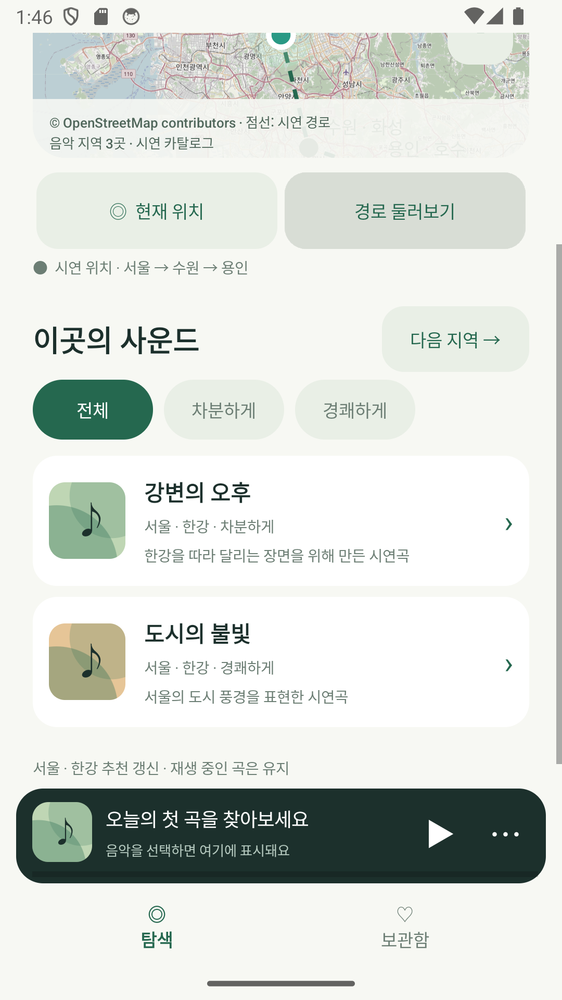
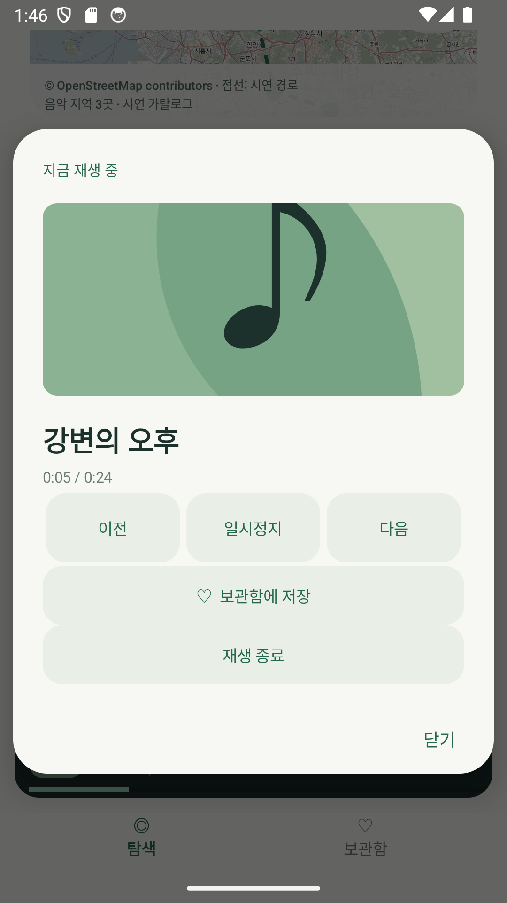
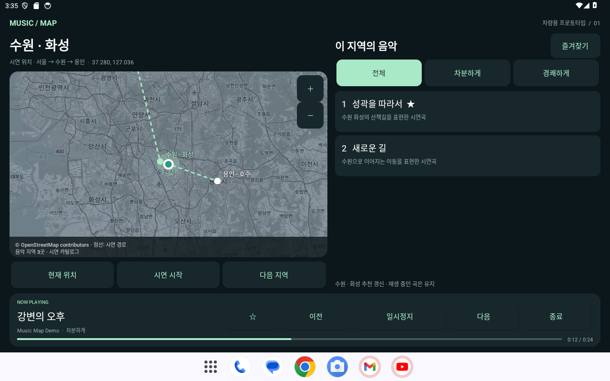

# 검증 기록

## 2026-11-09 세로 UI 검증 (KST)

- `assembleStandardDebug`, `testStandardDebugUnitTest`: 성공 (단위 테스트 6개).
- 일반 Android 에뮬레이터 실행 테스트: `PASS 14 checks`.
- Pixel_2의 해상도·배율 강제 설정을 초기화하고 1080×1920 / 420 dpi에서 세로 전용 화면 확인.
- 지도와 음악 목록의 세로 스크롤, 하단 탐색/보관함, 미니 플레이어,
  곡 선택, 재생 메뉴, 즐겨찾기 저장과 보관함 표시를 직접 확인.
- 이번 UI 변경 후 Pleos 에뮬레이터와 실차에서는 검증하지 않음.

## 초기 프로토타입 검증

검증일: 2026-11-08 (KST)

## 빌드와 정적 검사

- `assembleStandardDebug`: 성공
- `assemblePleosDebug`: 성공. 공식 FusedLocation 1.1.3 의존성과 타입 기반 구현을 컴파일함.
- `testStandardDebugUnitTest`: 6개 성공
- `lintStandardDebug`, `lintPleosDebug`: 오류 없음. SDK 버전 안내, 가로 화면,
  서비스 노출, 그리기 중 객체 생성, 한국어 문자열 등의 경고는 남아 있음.

## Android 실행 테스트

Android API 34 일반 에뮬레이터, 1280×800 / mdpi에서 실행.

1. 서울 시연 시작, 자동 재생 없음
2. 시스템 MediaBrowser가 지역별 재생 가능 콘텐츠 탐색
3. 내장 WAV 파일의 실제 MediaPlayer 재생
4. 수원 이동 시 서울 재생곡 유지, 추천만 수원으로 변경
5. MediaController 다음 곡 명령으로 수원 곡 재생
6. 즐겨찾기 메모리·SharedPreferences 저장
7. 장르별 추천 필터와 현재 곡 유지
8. Activity가 백그라운드에 있어도 재생 유지
9. 시스템 일시정지 명령
10. 시스템 검색 재생 명령
11. 용인으로 시연 이동, 현재 곡 유지
12. Android 테스트 GPS 제공자가 전달한 서울 좌표로 실제 위치 콜백과 지역 갱신 확인
13. 미등록 지역 좌표 수신 시 추천을 비우는 동작 확인
14. 종료 시 재생·시연 중지

실행 테스트 소스: `app/src/androidTest/java/com/musicmap/car/SmokeInstrumentation.kt`.
결과 파일: `build/verification/smoke-result.txt`.
추가로 타일이 로드된 초기 화면과 수원 이동 중 재생 화면을 캡처해 시각 확인함.

## 미검증 범위

- Pleos 2.1.0 에뮬레이터와 실차는 이 환경에 설치돼 있지 않음.
- Pleos 위치 권한 승인, FusedLocation 런타임 수신, 실제 GPS 주행 미검증.
  Android 위치 콜백 검증은 에뮬레이터의 테스트 GPS 제공자 주입을 사용함.
- AAOS CarUxRestrictions 연동 코드는 컴파일됐으나 실제 주행 상태 전환 미검증.
- 미디어 브라우저와 컨트롤러 테스트가 실제 스티어링 휠·Tune Knob 검증을 대체하지 않음.
- 오디오 포커스 상실, suspend/resume, API 28 기기, 네트워크 장애는 추가 실행 검증 필요.
- 상용 음악 공급·인증·재생 권한, 전국 지역 데이터, 최종 서명 release APK는 미완료.

이 결과는 동작하는 1차 프로토타입 검증이며 공모전 제출 적합성이나 차량 탑재 승인을 뜻하지 않음.
